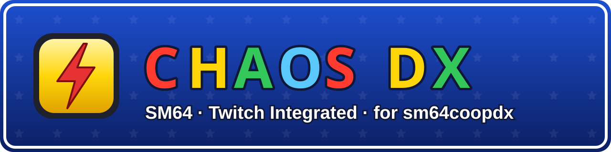
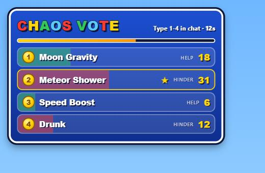
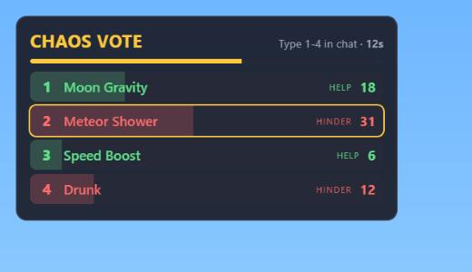
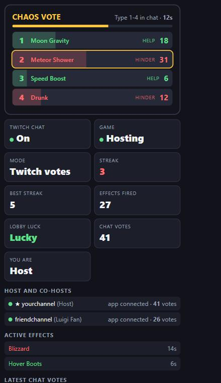
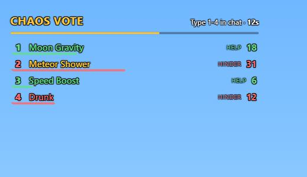
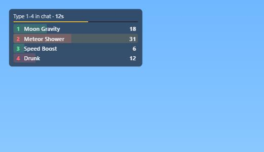

# Chaos DX SM64 (Twitch Integrated)

A chaos mod for **[sm64coopdx](https://github.com/coop-deluxe/sm64coopdx)** (Super Mario 64 Coop Deluxe). Every few seconds
something happens to the lobby: moon gravity, a blizzard, a meteor shower, reversed controls, a boss fight. You pick
how effects are chosen: at random, by a vote in the game, or by **your Twitch chat** typing numbers.

> **Why isn't this on the sm64coopdx mods site?** This project was made with the help of AI, and I don't believe it
> would be accepted there for that reason. So it lives here instead. See the [AI disclaimer](#ai-disclaimer).

## Downloads

| | Download | What it is |
|---|---|---|
| **Chaos DX mod** | [**Latest mod release**](https://github.com/Jayconius/chaos-dx-sm64/releases/tag/mod-v1.0.0) | The mod for sm64coopdx (a `chaos` folder) |
| **Chaos Companion app** | [**Latest app release**](https://github.com/Jayconius/chaos-dx-sm64/releases/tag/companion-v0.1.0) | Optional Windows app for Twitch chat voting and OBS overlays |

The game itself is **not** included. You need your own copy of sm64coopdx. Built and tested with **sm64coopdx v1.5.1**.

  
  

---

## What it does

- **52 effects**: 16 Help, 32 Hinder and 4 rare bosses. Movement, controls, weather, falling meteors and bombs,
  a Boo you can barely steer, a bird that carries you off, Hot Potato, Lights Out and more.
- **Three ways to pick effects**: random (RNG), lobby vote (`/vote 1-9`), or Twitch chat vote (with the Companion app).
- **Greed meter**: if the lobby keeps voting Help, fewer Help options show up; vote Hinder and they come back.
  Three Hinders in a row earns a longer Help (streak bonus).
- **Bosses** (Mega Goomba, Wiggler, King Whomp, Big Boo): beatable anywhere, last 1-3 minutes, and never drop a star.
- **Everything is synced** from the host, so every player sees the same chaos.
- **Host settings** in the mod menu: turn single effects off, set timings, vote options, boss placement and more.

## Installing the mod

1. Download **`chaos-dx-mod.zip`** from the [mod release](https://github.com/Jayconius/chaos-dx-sm64/releases/tag/mod-v1.0.0).
2. Unzip it. You get a folder called **`chaos`**. Keep that name, because the Companion app finds the mod by it.
3. Put the `chaos` folder in the **`mods`** folder next to `sm64coopdx.exe`
   (or in `%APPDATA%\sm64coopdx\mods`, which every copy of the game on your PC shares; just don't use both).
4. Start sm64coopdx, choose **Host**, open **Mods**, and turn on **Chaos DX**.
5. Host the game. Players who join get the mod automatically from you.

### Host settings (in game)

Pause the game, open the **mod menu**, and find **Chaos settings**:

| Setting | What it does |
|---|---|
| **Source** | 0 Off, 1 Random (RNG), 2 Lobby votes, 3 Twitch votes |
| **Vote options** | 1-9 options per vote (the Companion app sets this while it runs) |
| **Vote length / Time between effects** | In seconds |
| **Greed** | Off, Mild or Harsh |
| **Twitch mode: lobby /vote counts too** | Lets players in the game vote alongside Twitch chat |
| **Boss spawns** | 0 one per level, 1 near the host, 2 at the biggest group of players |
| **Keep chaos going during boss fights** | Untick to pause votes and effects while a boss is out |
| **Effect tick boxes** | Untick any effect you don't want. Your choices are saved |

### Chat commands

| Command | Who | What it does |
|---|---|---|
| `/vote 1`-`9` | Everyone | Vote in a lobby vote |
| `/chaos auto`, `/chaos vote`, `/chaos twitch`, `/chaos off` | Host | Pick how effects are chosen |
| `/chaos now <effect>` | Host | Fire an effect right now (e.g. `/chaos now meteor_shower`) |
| `/chaos list` | Host | Show every effect and its name for `/chaos now` |
| `/chaos clear` | Host | Stop all active effects |
| `/chaos enable <effect>` / `/chaos disable <effect>` | Host | Turn an effect on or off (`all` works too) |
| `/chaos cohost <player>` / `/chaos uncohost <player>` / `/chaos cohosts` | Host | Manage Twitch co-hosts |
| `/chaos log` | Host | Show the last 10 effects |

---

## Chaos Companion app (Twitch voting)

A small Windows app (about 3 MB, no installer) that reads your Twitch chat and sends the votes to the game. It reads
chat as a guest, so **no Twitch login or password is needed**: just your channel name.

### Setting it up

1. Download **`ChaosCompanion.exe`** from the [app release](https://github.com/Jayconius/chaos-dx-sm64/releases/tag/companion-v0.1.0)
   and run it. Windows may show a SmartScreen warning because the app isn't signed: choose **More info › Run anyway**.
2. Type your **Twitch channel name**, pick how many **vote options** to show (1-9), and click **Save and connect**.
   The status should say **Reading #yourchannel**.
3. In the game, host with Chaos DX on and set **Source** to **3 (Twitch)**, or type `/chaos twitch`.
4. When a vote opens, chat votes by typing a number.

### How chat votes are read

- The message has to **start** with the number: `1`, `111111`, `1! please`, `#2`, `!3` all count.
- `12`, `10`, `I pick 3`, or a number above the option count are ignored.
- **One vote per chatter per round.** Their first vote is final.

### OBS

| What | How to add it | URL |
|---|---|---|
| **Vote overlay** | Sources › **Browser**, about 520 × 520 | `http://127.0.0.1:7480/overlay` |
| **Stats dock** | Docks › **Custom Browser Docks** | `http://127.0.0.1:7480/dock` |

The app has **Copy** buttons for both. The dock shows Twitch and game status, current and best streak, effects
fired, lobby luck, live votes, active effects, the latest chat voters and your co-hosts.

**Overlay styles**: pick one in the app (it applies straight away), or force one per scene by adding
`?theme=classic`, `?theme=transparent`, `?theme=minimal` or `?theme=mario64` to the overlay URL.
Add `?preview=1` to see a sample vote while you set it up (remove it afterwards).

| Classic | Transparent | Minimal | Mario 64 |
|---|---|---|---|
|  |  |  |  |

### Co-hosts

Streaming together in the same game? Co-hosts' chats can vote too.

1. Each co-host joins the host's game and runs **Chaos Companion** with **their own** channel name.
2. The host adds them: in the app, pick the player under **Co-hosts** and click **+ Add co-host**
   (or type `/chaos cohost <player>` in game).
3. All co-hosts' chat votes are added to the host's. Every co-host's overlay and dock shows the same vote.

Don't combine co-hosting with Twitch's **shared chat** (Stream Together), or the same messages will be counted more
than once.

### Other options

- **Minimize to system tray**: tick it in the app to hide it to the tray when minimized.
- **Settings are saved** in `%APPDATA%\ChaosCompanion\settings.json`.

---

## Troubleshooting

| Problem | Try this |
|---|---|
| App says *Connecting…* forever | Check the channel name, then click **Reconnect chat** |
| App says the game is *Not found* | Host a game with Chaos DX turned on, and wait a few seconds |
| In-game vote shows **[app not connected]** | Start the Companion app, or restart it |
| Chat votes show in the app but not in game | Set **Source** to 3 (Twitch) |
| Host button does nothing | Your player limit is above what that copy of the game allows. Lower it in Host › Settings |

The app talks to the game through two small files in the game's save folder (`%APPDATA%\sm64coopdx\sav\chaos.sav`
and `chaos.modfs`). If you start the game with a custom `--savepath`, the app won't find it.

## Building from source

- **Mod**: plain Lua, no build step. The files are in [`mod/chaos`](mod/chaos). Core logic tests:
  `lua tests/core_test.lua` (Lua 5.4).
- **App**: [Tauri 2](https://tauri.app) with Rust and plain HTML/JS, in [`companion`](companion). You need Rust,
  Node.js and the Microsoft C++ Build Tools, then run `npm install` and `npx tauri build` in `companion`.
  Tests: `cargo test --release` in `companion/src-tauri`.
- Testing without Twitch or the game: [`tests/fake_twitch.py`](tests/fake_twitch.py) (a fake chat),
  [`tests/fake_app.py`](tests/fake_app.py) and [`tests/fake_state_server.py`](tests/fake_state_server.py).

## Not affiliated

Not affiliated with or endorsed by Nintendo, the sm64coopdx team, or Kaze Emanuar's *Super Mario 64: Chaos Edition*
(a separate, much older ROM hack). Super Mario 64 is a trademark of Nintendo. No game files or ROMs are included.

## Licence

[MIT](LICENSE)

## AI disclaimer

This project, the mod, the Companion app, the graphics and this README, was made with the help of AI (Anthropic's
Claude), directed, tested and played by me. The code is checked with automated tests and real play, but please report
anything that doesn't work as described.
